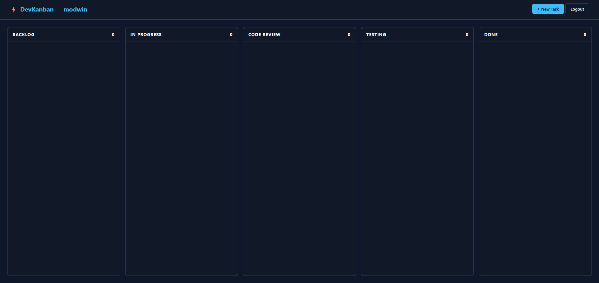

# Kanban.dev

A focused task management board designed specifically for software engineering teams working in Scrum/Agile workflows. Built with modern, strictly-typed PHP (PSR-7), MariaDB, and reactive Vanilla JavaScript.



## Background & Motivation
Generic board tools like Trello work well for general checklists, but lack native concepts essential to software engineering without third-party plugins. Developers typically need immediate visibility into:
- Git branch associations
- Story point estimates
- Strict issue categorization (Bugs vs. Features vs. Technical Debt)
- Blocker priorities (P0 to P4)
- A clear 5-stage progression pipeline (Backlog → In Progress → Code Review → Testing → Done)

Kanban.dev was built to provide an opinionated, lightweight alternative: keeping the board simple and fast while ensuring that core engineering metadata is visible at a glance directly on each task card.

---

## Technical Overview

### Architecture & Standards
The application follows a clean, layered architecture with strict typing (`declare(strict_types=1)`):

- **PSR-4 Autoloading**: Managed through Composer, mapping the `KanbanDev\` namespace directly to `src/`.
- **PSR-7 HTTP Abstraction**: Controllers consume `Psr\Http\Message\ServerRequestInterface` and return `Psr\Http\Message\ResponseInterface` using `guzzlehttp/psr7`.
- **Front Controller & Native Regex Router**: All incoming requests are matched against route patterns (supporting dynamic path parameters like `/api/cards/{id}/status`) without framework dependencies.
- **Data Transfer Objects (DTOs)**: `KanbanCardDto` and `UserDto` validate incoming payloads and enforce type boundaries before hitting the domain layer.
- **Domain Enums**: Backed PHP 8.2 enums enforce valid states across the system (`CardStatus`, `Priority`, `IssueType`, `UserRole`).
- **Repository Pattern**: All database interactions are encapsulated in `UserRepository` and `KanbanCardRepository`, using parameterized PDO statements to prevent SQL injection.
- **Database Wrapper**: A Singleton wrapper (`Database::getInstance()`) providing a persistent, single PDO connection per request cycle.
- **Security & Session Handling**:
   - Password hashing using `password_hash()` (`PASSWORD_DEFAULT`).
   - Session security configured with `session_regenerate_id(true)`, `HttpOnly`, `SameSite=Strict`, and user-scoped data isolation (`WHERE user_id = :id` on all card operations).

### Frontend Implementation
- **Zero Framework Overhead**: Built with Vanilla JavaScript using the modern `fetch` API for asynchronous updates without full page reloads.
- **Responsive Layout**: Designed with CSS Grid and Flexbox, featuring a low-fatigue dark theme with distinct color semantics for task types and priorities.

---

## Project Structure

```text
kanban.dev/
├── database/
│   └── 001-schema.sql         # Database schema (tables, foreign keys, indexes)
├── public/
│   ├── css/
│   │   └── styles.css         # Custom layout & dark mode styles
│   ├── js/
│   │   ├── app.js             # Board rendering & async card operations
│   │   └── login.js           # Auth & toggle logic
│   ├── .htaccess              # Apache rewrite rules for production
│   ├── index.php              # Front Controller entrypoint
│   └── router.php             # Router script for PHP built-in CLI server
├── src/
│   ├── Config/                # Environment variable loader
│   ├── Controller/            # HTTP handlers (Auth, KanbanCard, Page)
│   ├── Database/              # PDO connection singleton
│   ├── Dto/                   # Data Transfer Objects with validation
│   ├── Http/                  # Router, Route matcher, SessionManager
│   ├── Model/                 # Domain entities & Enums
│   ├── Repository/            # PDO data persistence
│   └── Service/               # Business logic & authentication rules
├── templates/
│   ├── index.html             # Kanban board view
│   └── login.html             # Authentication view
├── docker-compose.yml         # Container configuration for MariaDB
└── composer.json              # PSR-4 definitions & dependencies
```

---

## Getting Started

### Prerequisites
- PHP 8.2 or higher
- Composer
- Docker & Docker Compose

### 1. Clone & Configure
Clone the repository and set up your local environment file:

```bash
git clone https://github.com/modwin/kanban-dev.git
cd kanban-dev
cp .env.example .env
```

Ensure the database credentials in `.env` match your preferences (defaults are pre-configured for local development).

### 2. Install Dependencies
Install required PSR-7 packages and generate the PSR-4 autoloader:

```bash
composer install
```

### 3. Start Database Container
Start the containerized MariaDB service:

```bash
docker compose up -d
```
*Note: The initial database schema (`database/001-schema.sql`) will execute automatically on container creation.*

### 4. Start Local Development Server
Because PHP's built-in web server does not evaluate Apache `.htaccess` rewrite rules, run the built-in server with `public/router.php`. This router script serves existing static assets (`.css`, `.js`) directly and routes all other requests to `public/index.php`:

```bash
php -S 127.0.0.1:8000 -t public public/router.php
```

Visit [http://127.0.0.1:8000](http://127.0.0.1:8000) in your browser.

---

## API Overview

| Method | Endpoint | Description |
| :--- | :--- | :--- |
| `POST` | `/api/auth/register` | Register a new user |
| `POST` | `/api/auth/login` | Authenticate user & start session |
| `POST` | `/api/auth/logout` | Invalidate session |
| `GET` | `/api/auth/me` | Fetch authenticated user details |
| `GET` | `/api/cards` | Retrieve all cards for authenticated user |
| `POST` | `/api/cards` | Create a new task card |
| `PATCH`| `/api/cards/{id}/status`| Update card status column |
| `DELETE`| `/api/cards/{id}` | Delete card |