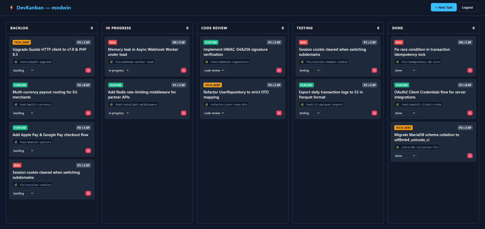
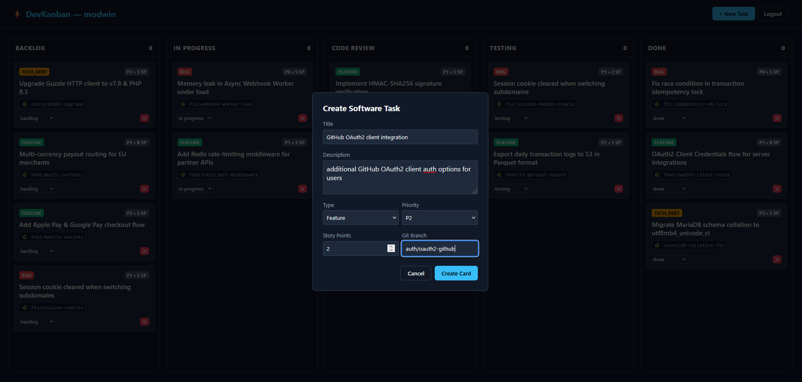
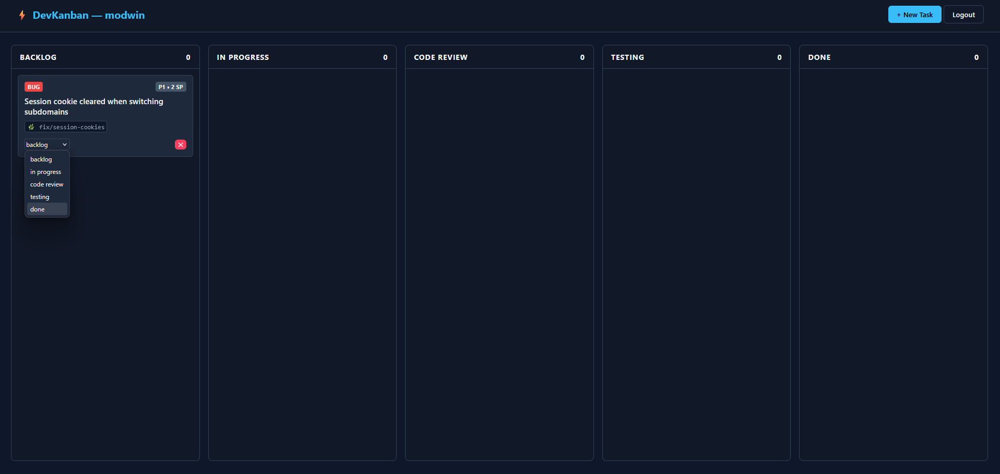

# Kanban.dev [](https://kanbandev.app)


A task management web application designed for software engineering workflows. Built from scratch with PHP 8.2 (PSR-7), MariaDB, and Vanilla JavaScript.



## Overview

Generic tools like Trello require extra setup or plugins to track engineering metadata. **Kanban.dev** builds these concepts directly into each card:

* **Git Branch Tagging** (`fix/auth`, `feat/rate`)
* **Story Point Estimation** & **Prioritization** (P0 Blocker through P4)
* **Issue Categorization** (Bugs, Features, Tech Debt with custom visual indicators)
* **5-Stage Pipeline** (Backlog → In Progress → Code Review → Testing → Done)

---

## Interface & Workflow

<table width="100%">
  <tr>
    <td width="50%" align="center">
      <b>Task Creation & Metadata Entry</b><br/><br/>
      
    </td>
    <td width="50%" align="center">
      <b>Status Updates & Column Moves</b><br/><br/>
      
    </td>
  </tr>
</table>

---

## Architecture & Technical Choices

The backend is built without full-stack frameworks (like Laravel or Symfony) to maintain a transparent, decoupled REST architecture.

* **Routing & Front Controller**: Single entry point (`public/index.php`) running a native regex-based router mapping endpoints to controllers.
* **PSR-7 & PSR-4**: Uses `guzzlehttp/psr7` for HTTP request/response abstractions and Composer PSR-4 autoloading (`KanbanDev\`).
* **Type Safety**: PHP 8.2 backed Enums (`CardStatus`, `Priority`, `IssueType`) enforce valid states across DTOs, Repositories, and the database layer.
* **Data Layer**: PDO-backed Repository pattern with strict parameters to prevent SQL injection. Managed via a single-connection Singleton wrapper per request.
* **Security & Auth**: Native PHP session handling (`HttpOnly`, `SameSite=Strict`, `session_regenerate_id()`), password hashing via `password_hash()`, and strict user-isolated database queries (`WHERE user_id = :id`).
* **Frontend**: Pure HTML5, CSS Grid/Flexbox, and asynchronous `fetch` calls. No frontend build steps, transpirers, or external JS dependencies.

---

## Project Structure

```text
kanban.dev/
├── database/
│   └── 001-schema.sql         # Database schema (tables, foreign keys, indexes)
├── public/
│   ├── css/
│   │   └── styles.css         # Layout & dark mode styles
│   ├── js/
│   │   ├── app.js             # Board rendering & async fetch operations
│   │   └── login.js           # Auth handlers
│   ├── .htaccess              # Apache rewrite rules
│   ├── index.php              # Front Controller entrypoint
│   └── router.php             # Router script for PHP CLI server
├── src/
│   ├── Config/                # Environment loader
│   ├── Controller/            # HTTP Controllers (Auth, Card, Page)
│   ├── Database/              # PDO connection singleton
│   ├── Dto/                   # Data Transfer Objects
│   ├── Http/                  # Router, Route matcher, Session manager
│   ├── Model/                 # Domain entities & Enums
│   ├── Repository/            # PDO persistence layer
│   └── Service/               # Business logic
├── templates/
│   ├── index.html             # Main Kanban view
│   └── login.html             # Auth view
├── docker-compose.yml         # MariaDB container setup
└── composer.json              # PSR-4 definitions & dependencies
```

---
## Coming future features
* **OAuth2 & JWT account creation/signin**
* **Kanban projects**
* **User-associated savable collections of kanban-boards**
* **Shared boards to collaborade among users**
* **Improved mobile interface**
## Getting Started

### Prerequisites
- PHP 8.2 or higher
- Composer
- Docker & Docker Compose
- .env config file with configured database credentials [.env.example](.env.example)

### 1. Clone & Configure
Clone the repository and set up your local environment file:

```bash
git clone https://github.com/modwin/kanban-dev.git
cd kanban-dev
cp .env.example .env
```

Ensure the database credentials in `.env` match your preferences (defaults are pre-configured for local development).

### 2. Install Dependencies
Install required PSR-7 packages and generate the PSR-4 autoloader:

```bash
composer install
```

### 3. Start Database Container
Start the containerized MariaDB service:

```bash
docker compose up -d
```
*Note: The initial database schema (`database/001-schema.sql`) will execute automatically on container creation.*

### 4. Start Local Development Server
Because PHP's built-in web server does not evaluate Apache `.htaccess` rewrite rules, run the built-in server with `public/router.php`. This router script serves existing static assets (`.css`, `.js`) directly and routes all other requests to `public/index.php`:

```bash
php -S 127.0.0.1:8000 -t public public/router.php
```

Visit [http://127.0.0.1:8000](http://127.0.0.1:8000) in your browser.

---

## API Overview

| Method | Endpoint | Description |
| :--- | :--- | :--- |
| `POST` | `/api/auth/register` | Register a new user |
| `POST` | `/api/auth/login` | Authenticate user & start session |
| `POST` | `/api/auth/logout` | Invalidate session |
| `GET` | `/api/auth/me` | Fetch authenticated user details |
| `GET` | `/api/cards` | Retrieve all cards for authenticated user |
| `POST` | `/api/cards` | Create a new task card |
| `PATCH`| `/api/cards/{id}/status`| Update card status column |
| `DELETE`| `/api/cards/{id}` | Delete card |
